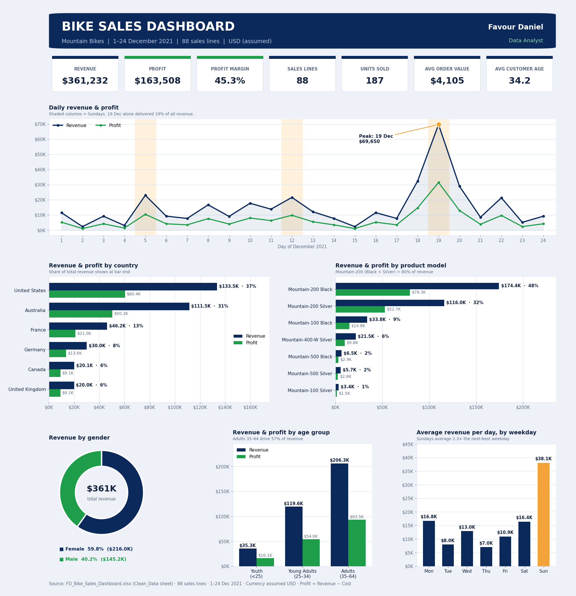
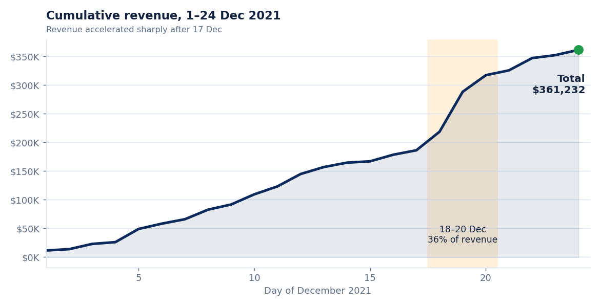
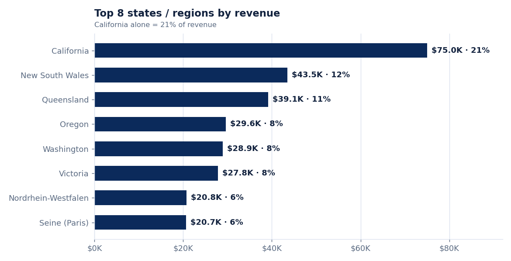
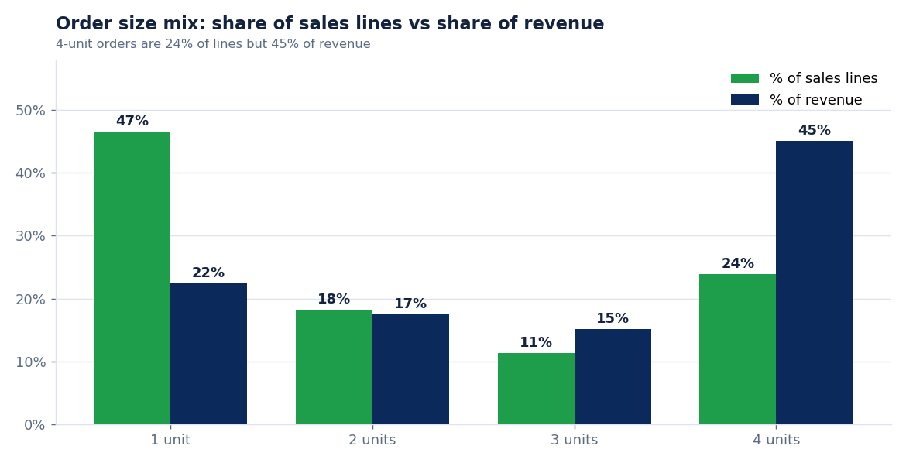

# 🚲 Bike Sales Analysis: Mountain Bikes, December 2021

**An Excel-based sales analysis and interactive dashboard covering 88 sales lines, 187 units and $361K in revenue across six countries.**

*Prepared by Favour Daniel, Data Analyst*



> The dashboard above is a static snapshot of the Excel dashboard in [`data/FD_Bike_Sales_Dashboard.xlsx`](data/FD_Bike_Sales_Dashboard.xlsx). In Excel it is interactive: the **Country**, **Gender** and **Age group** drop-downs on the `Dashboard` sheet re-calculate every KPI, table and chart.

---

## Table of contents

1. [Executive summary](#1-executive-summary)
2. [Dataset and scope](#2-dataset-and-scope)
3. [Methodology and data cleaning](#3-methodology-and-data-cleaning)
4. [Headline KPIs](#4-headline-kpis)
5. [Findings](#5-findings)
   - [5.1 Sales over time](#51-sales-over-time)
   - [5.2 Geography](#52-geography)
   - [5.3 Products](#53-products)
   - [5.4 Customers](#54-customers)
   - [5.5 Order size](#55-order-size)
6. [Recommendations](#6-recommendations)
7. [Limitations](#7-limitations)
8. [Repository structure](#8-repository-structure)
9. [Tools used](#9-tools-used)

---

## 1. Executive summary

Between **1 and 24 December 2021**, the Mountain Bikes line generated **$361,232 in revenue** and **$163,508 in profit**, a **45.3% profit margin**, from **187 bikes** sold across **88 sales lines**.

**What stands out**

- **One product carries the business.** The Mountain-200 (Black and Silver) delivered **80% of revenue** and 67% of units. Black alone was 48% of revenue.
- **Two markets make up two-thirds of sales.** The United States (37%) and Australia (31%) together generated **68% of revenue**. California was the single biggest region at 21%.
- **Sales were very spiky.** **19 December** brought in **$69,650, or 19% of the month's revenue**, and 18–20 December together delivered **36%**. Excluding 19 December, the daily average falls from $15,051 to $12,677.
- **Sundays are the strongest day.** Sundays averaged **$38.1K per day**, about 2.3× the next-best weekday.
- **Bigger baskets drive revenue.** Orders of four units were 24% of sales lines but **45% of revenue**.
- **Margin is flat, so volume and mix matter more.** Every country and nearly every model earns about 45% margin. The one exception is the premium Mountain-100 at 43.8%.
- **Female customers generated 60% of revenue** ($216K), and Adults aged 35–64 generated 57%.

---

## 2. Dataset and scope

| Item | Detail |
|---|---|
| Source file | `FD_Bike_Sales_Dashboard.xlsx` |
| Period | 1 – 24 December 2021 (24 days) |
| Product scope | Bikes › Mountain Bikes (7 models, Mountain-100 to Mountain-500) |
| Records | 88 sales lines (87 unique order numbers; order #261695 appears twice for two different customers) |
| Markets | United States, Australia, France, Germany, Canada, United Kingdom (17 states / regions) |
| Customer fields | Age, age group, gender |
| Currency | Not stated in the source; **USD is assumed** |

**Workbook sheets**

| Sheet | Purpose |
|---|---|
| `FD Raw Data` | Original data as received |
| `Clean_Data` | Cleaned records plus derived fields (Model, Size, Week, Weekday) |
| `Analysis` | Calculation tables behind the dashboard (filter-aware formulas) |
| `Dashboard` | KPI cards, five charts and live key insights with three filters |
| `Indicators` | Catalogue of further indicators that could be built from this data |
| `Data_Notes` | Cleaning log and assumptions |

---

## 3. Methodology and data cleaning

### Metric definitions

| Metric | Definition |
|---|---|
| Revenue | Order quantity × unit price |
| Cost | Order quantity × unit cost |
| Profit | Revenue − Cost |
| Profit margin | Profit ÷ Revenue |
| Orders (sales lines) | Count of rows in `Clean_Data` |
| Average order value (AOV) | Revenue ÷ sales lines |
| Week | 7-day blocks (days 1–7, 8–14, 15–21, 22–28); week 4 contains only 3 days of data |

### Cleaning log

Ten corrections were made across **9 of the 88 records (about 10%)**. Cost, Revenue and Profit were rebuilt as formulas and match the original on every row not listed below.

| Original row | Column | Issue | Fix applied |
|---:|---|---|---|
| 4 | Country | Extra spaces (`" United States"`) | Trimmed |
| 6 | Country | Double space (`"United  States"`) | Trimmed |
| 6 | Unit_Cost | Value was 0 (cost and profit inconsistent) | Replaced with 1,252, the cost of the same product elsewhere |
| 8 | Country | Trailing space | Trimmed |
| 9 | Unit_Price | Value was 0 (revenue 0 but profit positive) | Replaced with 769, the price of the same product elsewhere |
| 11 | Day | Blank | Filled from the Date column |
| 16 | Age_Group | Blank | Derived from Customer_Age (36) → Adults (35-64) |
| 18 | Month | Typo `"Decmber"` | Corrected to "December" |
| 22 | Product_Description | Blank | Model inferred from unit cost/price → Mountain-200 Black (size unknown) |
| 23 | Order_Quantity | Blank (cost and revenue were 0) | Set to 1, implied by recorded profit ÷ unit margin |

Other handling: three blank rows and a stray text line at the bottom of the raw sheet were excluded, and stray text in one cell was ignored.

> **Note:** Four of these fixes (rows 6, 9, 22, 23) involve inferred values. They are small relative to the totals, but they are assumptions rather than observed facts.

---

## 4. Headline KPIs

| KPI | Value |
|---|---:|
| Revenue | **$361,232** |
| Cost | $197,724 |
| Profit | **$163,508** |
| Profit margin | **45.3%** |
| Sales lines | 88 |
| Units sold | 187 |
| Average order value | $4,105 |
| Average revenue per unit | $1,932 |
| Average profit per unit | $874 |
| Average customer age | 34.2 years |

*Customer ages in the data range from 17 to 63, with a median of 35.*

---

## 5. Findings

### 5.1 Sales over time

| Block | Days | Revenue | Profit | Sales lines |
|---|---|---:|---:|---:|
| Week 1 | 1–7 Dec | $65,971 | $29,973 | 18 |
| Week 2 | 8–14 Dec | $98,662 | $44,658 | 29 |
| Week 3 | 15–21 Dec | $160,944 | $72,675 | 31 |
| Week 4 (partial) | 22–24 Dec | $35,655 | $16,202 | 10 |



- **Revenue climbed week by week** until week 3, which delivered 45% of the month's revenue. Week 4 contains only three days, so its total should not be read as a decline: it averages $11.9K per day versus $23.0K in week 3.
- **19 December ($69,650) is a clear outlier.** It contained 10 sales lines and 33 units (18% of all units), and seven of those lines were four-bike orders. The median day was only $10,359.
- **The daily trend is volatile.** Only 8 of 24 days beat the $15,051 daily average.

**Average revenue per day, by weekday**

| Weekday | Days in period | Total revenue | Avg per day |
|---|---:|---:|---:|
| Sunday | 3 | $114,211 | **$38,070** |
| Monday | 3 | $50,272 | $16,757 |
| Saturday | 3 | $49,190 | $16,397 |
| Wednesday | 4 | $51,810 | $12,953 |
| Friday | 4 | $43,799 | $10,950 |
| Tuesday | 3 | $23,918 | $7,973 |
| Thursday | 4 | $28,032 | $7,008 |

Because the period contains only three Sundays, and one of them is the 19 December spike, the Sunday effect is suggestive rather than conclusive.

### 5.2 Geography

| Country | Revenue | Share | Profit | Margin | Units | Sales lines | Revenue per unit |
|---|---:|---:|---:|---:|---:|---:|---:|
| United States | $133,489 | 37.0% | $60,370 | 45.2% | 66 | 32 | $2,023 |
| Australia | $111,506 | 30.9% | $50,326 | 45.1% | 63 | 27 | $1,770 |
| France | $46,175 | 12.8% | $20,981 | 45.4% | 20 | 8 | $2,309 |
| Germany | $30,010 | 8.3% | $13,636 | 45.4% | 13 | 6 | $2,308 |
| Canada | $20,080 | 5.6% | $9,123 | 45.4% | 11 | 6 | $1,825 |
| United Kingdom | $19,972 | 5.5% | $9,072 | 45.4% | 14 | 9 | $1,427 |



- **US + Australia = 68% of revenue.** California ($75.0K), New South Wales ($43.5K) and Queensland ($39.1K) are the top three regions.
- **Profit margin is virtually identical across countries (45.1–45.4%)**, so geographic differences come from volume and product mix, not pricing power.
- **Mix explains the differences in revenue per unit.** Every sales line in France and Germany was a Mountain-200, giving them the highest revenue per unit ($2,309). The UK has the lowest ($1,427) because 8 of its 14 units were the lower-priced Mountain-400-W.
- Countries other than the US and Australia have only 6–9 sales lines each, so country-level comparisons for them are based on very small samples.

### 5.3 Products

| Model | Revenue | Share | Profit | Margin | Units | Lines | Profit per unit |
|---|---:|---:|---:|---:|---:|---:|---:|
| Mountain-200 Black | $174,420 | 48.3% | $79,268 | 45.4% | 76 | 35 | $1,043 |
| Mountain-200 Silver | $116,000 | 32.1% | $52,700 | 45.4% | 50 | 27 | $1,054 |
| Mountain-100 Black | $33,750 | 9.3% | $14,770 | 43.8% | 10 | 3 | $1,477 |
| Mountain-400-W Silver | $21,532 | 6.0% | $9,772 | 45.4% | 28 | 12 | $349 |
| Mountain-500 Black | $6,480 | 1.8% | $2,940 | 45.4% | 12 | 6 | $245 |
| Mountain-500 Silver | $5,650 | 1.6% | $2,570 | 45.5% | 10 | 4 | $257 |
| Mountain-100 Silver | $3,400 | 0.9% | $1,488 | 43.8% | 1 | 1 | $1,488 |

- **Mountain-200 is the engine:** 126 of 187 units (67%) and **80% of revenue** ($290,420).
- **Mountain-100 is the premium tier.** It earns the highest profit per unit (about $1,480) but at a slightly lower margin (43.8% vs about 45.4% elsewhere), and it sold only 11 units. A single large order can move this model's numbers considerably.
- **Mountain-500 is the entry tier.** It accounts for 12% of units but only 3% of revenue.
- **Colour:** Black generated 59% of revenue ($214,650, 98 units) and Silver 41% ($146,582, 89 units).
- **Size:** sizes 38, 42 and 46 accounted for 169 of 187 units (**90%**). Sizes 40, 44, 48 and 52 together sold only 16 units.
- The workbook's "highest-margin model" insight (Mountain-500 Silver, 45.5%) is correct, but the spread between models is only about 0.1 percentage points, so it is not a meaningful differentiator outside the Mountain-100 series.

### 5.4 Customers

| Segment | Revenue | Share | Profit | Units | Sales lines | Revenue per line |
|---|---:|---:|---:|---:|---:|---:|
| **Female** | $216,049 | 59.8% | $97,543 | 108 | 50 | $4,321 |
| **Male** | $145,183 | 40.2% | $65,965 | 79 | 38 | $3,821 |
| Youth (<25) | $35,330 | 9.8% | $16,050 | 27 | 10 | $3,533 |
| Young Adults (25–34) | $119,646 | 33.1% | $53,962 | 61 | 31 | $3,860 |
| Adults (35–64) | $206,256 | 57.1% | $93,496 | 99 | 47 | $4,388 |

- **Women generated 60% of revenue** from 57% of sales lines, with about 13% higher revenue per line than men. Average age is nearly identical for both groups (34.2 vs 34.1).
- **Adults aged 35–64 are the core segment**, with the highest revenue per line ($4,388).
- **Youth customers are a small group** (10 lines), so conclusions about them should be treated cautiously.

### 5.5 Order size



| Units in order | Sales lines | % of lines | Revenue | % of revenue |
|---:|---:|---:|---:|---:|
| 1 | 41 | 46.6% | $80,771 | 22.4% |
| 2 | 16 | 18.2% | $63,084 | 17.5% |
| 3 | 10 | 11.4% | $54,729 | 15.2% |
| 4 | 21 | 23.9% | $162,648 | **45.0%** |

Nearly half of all sales lines are single bikes, yet the 21 four-unit orders produce roughly twice the revenue of all single-bike sales combined. Because no customer ID exists, it is not possible to tell whether these are retail multi-buyers, families, or resellers.

---

## 6. Recommendations

These are based only on what the data shows. Each should be validated against context the dataset does not contain (promotions, stock, seasonality).

1. **Protect Mountain-200 availability.** It drives 80% of revenue, and sizes 38, 42 and 46 drive 90% of units. Prioritise stock of these variants, especially Black.
2. **Find out what drove 18–20 December.** Establish whether a promotion, holiday gifting, a shipping cut-off or a bulk buyer explains the spike. If it was a repeatable driver, plan for it; if it was a one-off, avoid building forecasts on it.
3. **Test volume incentives.** Four-unit orders produce 45% of revenue. A bundle or multi-bike offer could be tested to see whether it raises the share of larger baskets.
4. **Review Mountain-100 pricing and costs.** It earns the most profit per unit but a lower margin than every other model. A small price or cost adjustment could lift profit on a high-value product.
5. **Look at the UK and Canada product mix.** Their revenue per unit is the lowest, and the UK leans on Mountain-400-W. Check whether Mountain-200 is fully available and marketed there.
6. **Keep marketing balanced but informed by the buyer profile.** Women and Adults aged 35–64 account for the largest revenue shares; confirm with campaign data before shifting spend.
7. **Extend the dataset.** Add more months, categories (accessories, clothing) and a customer ID so that seasonality, repeat purchase and cross-selling can be measured.

---

## 7. Limitations

- **Short window:** only 24 days of one month, so no month-over-month or year-over-year comparison, and any seasonality (such as December holiday demand) cannot be separated from underlying demand. The data stops on 24 December, so the low final days reflect an incomplete period, not necessarily weak demand.
- **Single category:** only Bikes › Mountain Bikes, so no category or sub-category comparison.
- **Small samples:** many segments (smaller countries, Youth customers, Mountain-100, Mountain-500) have fewer than 12 sales lines.
- **No discount, return or customer-ID fields:** discount analysis, returns, repeat purchase and retention cannot be measured.
- **Imputed values:** four cleaning fixes rely on inference (see section 3).
- **Currency assumed to be USD.**

---

## 8. Repository structure

```
bike-sales-analysis/
├── README.md                          ← this report
├── data/
│   └── FD_Bike_Sales_Dashboard.xlsx   ← interactive Excel dashboard + data + analysis
└── images/
    ├── dashboard.png                  ← dashboard snapshot
    ├── cumulative_revenue.png
    ├── order_size_mix.png
    └── top_states.png
```

**To explore interactively:** download the workbook, open the `Dashboard` sheet and use the Country, Gender and Age group drop-downs in row 4.

---

## 9. Tools used

- **Microsoft Excel**: data cleaning, formula-driven analysis tables, interactive dashboard with filters
- **Python (pandas, matplotlib)**: independent verification of the Excel figures and the static dashboard image

---

*Questions or feedback are welcome via the repository's Issues tab.*
